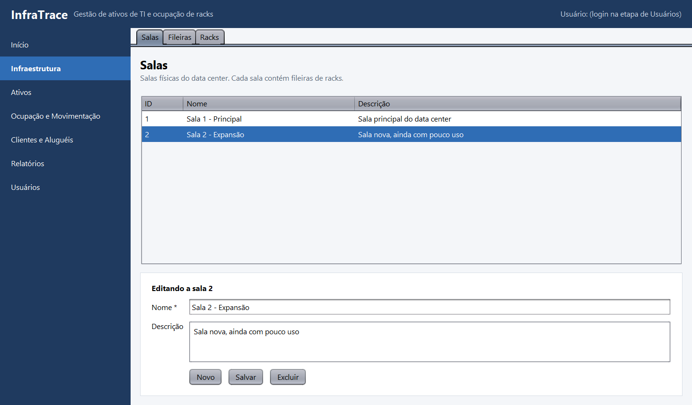

# Etapa 6.3 — Tela principal e cadastro de salas (Swing)

Primeira tela de verdade. A partir desta etapa, o **Run** (F6) do NetBeans abre a janela
principal (classe `App`). O `TesteConexao` continua disponível: botão direito nele → *Run File*.

> **Atualização (etapa 6.7):** a janela principal mudou. O menu lateral, o cabeçalho, a tela de
> Início e os cartões "em construção" saíram: agora são só as abas Sala, Fileira, Rack, Ativo e
> Tipo Ativo, com o visual do sistema (sem Nimbus) e mensagens sem cor. Os pacotes também foram
> renomeados (ex.: `br.com.infratrace.view` → `View`). As camadas e o fluxo descritos aqui
> continuam valendo. Veja [etapa-6.7.md](etapa-6.7.md).



## 1. As camadas em ação: o que acontece ao clicar em "Salvar"

```
PainelSalas (view)          o usuário digita o nome e clica em Salvar
   │  botaoSalvar → controller.salvar()
   ▼
SalaController (controller) lê os campos da tela e monta um objeto Sala
   │  service.salvar(sala)
   ▼
SalaService (service)       valida (nome obrigatório, até 128 caracteres)
   │  abre a conexão e decide: id vazio = INSERT, id preenchido = UPDATE
   ▼
SalaDAO (dao)               executa o SQL com PreparedStatement
   ▼
MySQL                       grava, ou recusa (UNIQUE → erro 1062)
```

O caminho de volta:
- **Deu certo:** o controller manda a tela recarregar a tabela, selecionar a sala gravada e
  mostrar a mensagem verde "Sala ... cadastrada".
- **Regra violada** (nome vazio, nome repetido, sala com fileiras): o service lança
  `NegocioException` com a mensagem pronta e o controller mostra um aviso amarelo.
- **Erro de banco** (MySQL desligado, senha errada...): chega uma `SQLException`, o
  `ErrosBanco.traduzir` converte o código em texto e o controller mostra um erro vermelho.

## 2. Responsabilidade de cada classe nova

| Classe | Camada | Responsabilidade |
|---|---|---|
| `App` | — | Ponto de partida: aplica o visual Nimbus e abre a `TelaPrincipal` na thread do Swing (EDT) |
| `view/TelaPrincipal` | view | Janela com cabeçalho, menu de módulos e `CardLayout` (um "cartão" por módulo) |
| `view/PainelSalas` | view | Tabela + formulário de salas. Só desenha e repassa cliques; não tem SQL nem regra |
| `view/Estilo` | view | Cores, fontes e cabeçalho padrão, para todas as telas ficarem iguais |
| `controller/SalaController` | controller | Recebe o clique, chama o service e diz à tela o que mostrar (inclusive os erros) |
| `service/SalaService` | service | Validações e tradução dos erros 1062 (nome repetido) e 1451 (sala com fileiras) |
| `service/Validacoes` | service | Validações reaproveitáveis: texto obrigatório e tamanho máximo |
| `exception/NegocioException` | exception | Erro que o usuário pode corrigir, com mensagem pronta |
| `exception/ErrosBanco` | exception | Códigos de erro do MySQL e tradução para mensagens |
| `dao/SalaDAO` | dao | Ganhou `atualizar` e `excluir` (que a tela precisa) |

## 3. Decisões que vale saber explicar

- **Por que o nome repetido não é conferido com um SELECT antes do INSERT?** Porque o banco
  já garante isso com o `UNIQUE (sal_nome)`. O service deixa o MySQL recusar e traduz o
  erro 1062. Isso funciona mesmo se dois usuários salvarem ao mesmo tempo; um SELECT antes
  não funcionaria.
- **Por que não tem `setAutoCommit(false)` aqui?** Cada operação de sala é um único comando
  SQL. A transação manual entra quando uma operação tem vários comandos que precisam ser
  gravados juntos (ex.: descarte de ativo = INSERT em `movimentacao` + UPDATE em `ativo`).
- **Quando a tabela é carregada?** Sempre que a tela aparece (o `HierarchyListener` do
  `PainelSalas`). Assim, ao voltar para o módulo, os dados estão atualizados.
- **Por que `SwingUtilities.invokeLater` no `App`?** O Swing exige que as telas sejam
  criadas e alteradas por uma única thread, a EDT.

## 4. Roteiro de teste (no NetBeans, com `dados_exemplo.sql` carregado)

| Ação | Resultado esperado |
|---|---|
| Menu **Infraestrutura** | Aba Salas com 2 salas |
| Clicar na "Sala 2 - Expansão" | Formulário mostra "Editando a sala 2" e o botão Excluir é liberado |
| **Novo** → nome "Sala 3 - Laboratório" → **Salvar** | Nova linha na tabela e mensagem verde com o id |
| **Novo** → nome "Sala 1 - Principal" → **Salvar** | Aviso: "Já existe uma sala com o nome 'Sala 1 - Principal'." |
| **Novo** → nome vazio → **Salvar** | Aviso: "O campo 'Nome' é obrigatório." |
| Selecionar "Sala 1 - Principal" → **Excluir** → Sim | Aviso: a sala tem fileiras e não pode ser excluída (erro 1451 traduzido) |
| Selecionar a "Sala 3 - Laboratório" → **Excluir** → Sim | Sala removida e mensagem verde |
| Parar o serviço MySQL80 e abrir Infraestrutura | Erro: "Não foi possível conectar ao MySQL..." |

## 5. Exercício do grupo: a aba Fileiras

> **Atualização:** a aba Fileiras foi feita na etapa 6.4 ([docs/etapa-6.4.md](etapa-6.4.md)).
> O exercício do grupo passou a ser a aba **Racks**.

A aba **Fileiras** segue o mesmo padrão da aba Salas. Sugestão de ordem:

1. `model/Fileira`: `id`, `nome`, `salaId` e `salaNome` (para mostrar na tabela).
2. `dao/FileiraDAO`: `listar` (com `JOIN sala` para trazer o nome da sala), `inserir`,
   `atualizar` e `excluir`.
3. `service/FileiraService`: nome obrigatório com **até 10 caracteres** (`VARCHAR(10)`), sala
   obrigatória, erro 1062 → "Já existe a fileira 'A' nesta sala" (o UNIQUE é
   `(fk_sal_id, fil_nome)`), erro 1451 → "A fileira tem racks".
4. `controller/FileiraController` e `view/PainelFileiras`: igual ao de salas, com um
   `JComboBox<Sala>` para escolher a sala. O combo mostra o nome porque `Sala.toString()`
   devolve o nome.

Se o grupo preferir, eu faço a aba Fileiras e vocês fazem a aba Racks, que é parecida
(com um combo de fileiras e o campo de capacidade de 1 a 60).
