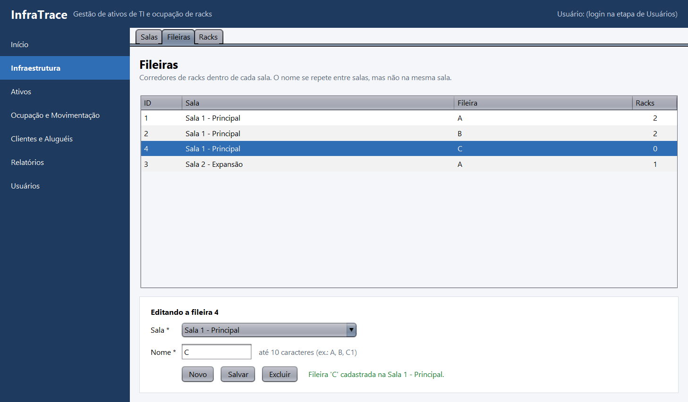

# Etapa 6.4 — Aba Fileiras

A aba **Fileiras** (menu Infraestrutura) segue o mesmo padrão da aba Salas, com duas novidades:
uma consulta com `JOIN`/`LEFT JOIN`/`COUNT` e um campo de escolha (`JComboBox`) ligado a outra tabela.

> **Atualização (etapa 6.7):** o menu Infraestrutura saiu. Fileira agora é uma aba da janela
> principal, com o botão **Atualizar**. Veja [etapa-6.7.md](etapa-6.7.md).



## 1. Classes novas e alteradas

| Classe | Camada | O que faz |
|---|---|---|
| `model/Fileira` | model | `id`, `nome`, `salaId` (colunas) + `salaNome` e `quantidadeRacks` (só para exibição, vêm da consulta) |
| `dao/FileiraDAO` | dao | `listar` (com JOIN e contagem de racks), `inserir`, `atualizar`, `excluir` |
| `service/FileiraService` | service | Nome obrigatório até 10 caracteres, sala obrigatória, tradução dos erros 1062, 1452 e 1451 |
| `controller/FileiraController` | controller | Usa **dois** services: `SalaService` (salas do combo) e `FileiraService` (fileiras da tabela) |
| `view/PainelFileiras` | view | Tabela (ID, Sala, Fileira, Racks) + formulário com combo de salas |
| `view/PainelBase` | view | **Novo.** O que toda tela de cadastro faz igual: mensagens, confirmação, formato da tabela, caixa do formulário e linha de botões |
| `controller/TratamentoDeErros` | controller | **Novo.** Decide como mostrar cada tipo de erro, igual em todas as telas |
| `PainelSalas`, `SalaController` | — | Passaram a usar `PainelBase` e `TratamentoDeErros`. O comportamento não mudou |

**Por que `PainelBase` e `TratamentoDeErros` só apareceram agora?** Com uma tela só, não havia
repetição. Com a segunda tela, o mesmo código de mensagens e de tratamento de erros ia aparecer
duas vezes (e depois em Racks, Ativos, Usuários...). Juntar no segundo uso evita copiar e colar
sem criar abstração antes da hora.

## 2. A consulta das fileiras

```sql
SELECT f.fil_id, f.fil_nome, f.fk_sal_id, s.sal_nome,
       COUNT(r.rac_id) AS qtd_racks
  FROM fileira f
  JOIN sala s      ON s.sal_id = f.fk_sal_id     -- toda fileira tem sala: JOIN normal
  LEFT JOIN rack r ON r.fk_fil_id = f.fil_id     -- LEFT: fileira sem rack também aparece
 GROUP BY f.fil_id, f.fil_nome, f.fk_sal_id, s.sal_nome
 ORDER BY s.sal_nome, f.fil_nome
```

- Com `JOIN rack` (sem LEFT), uma fileira **sem racks sumiria** da lista.
- `COUNT(r.rac_id)` conta só as linhas em que o LEFT JOIN achou rack. Para fileira vazia, o
  `r.rac_id` vem NULL e o COUNT dá 0. Já `COUNT(*)` daria 1, porque contaria a própria linha da fileira.
- A coluna **Racks** mostra ao usuário, antes de ele tentar, por que uma fileira não pode ser excluída.

## 3. O campo "Sala" (JComboBox)

- O combo guarda **objetos `Sala` inteiros** e mostra o que `Sala.toString()` devolve (o nome).
  Ao salvar, o controller pega a sala escolhida e usa o `getId()` dela.
- As salas são recarregadas toda vez que a aba aparece: uma sala criada na aba Salas já
  aparece aqui.
- O botão **Novo** mantém a sala escolhida, para cadastrar rápido várias fileiras (A, B, C...)
  na mesma sala.

## 4. Roteiro de teste (com `dados_exemplo.sql`)

| Ação | Resultado esperado |
|---|---|
| Abrir a aba Fileiras | 3 fileiras: Sala 1 › A (2 racks), Sala 1 › B (2 racks), Sala 2 › A (1 rack) |
| Novo → Sala 1 → nome "C" → Salvar | Nova linha com 0 racks e mensagem verde |
| Novo → Sala 1 → nome "A" → Salvar | Aviso: "Esta sala já tem uma fileira chamada 'A'." (UNIQUE → 1062) |
| Novo → Sala 2 → nome "B" → Salvar | Funciona: o nome é único só **dentro** da sala |
| Novo → sem escolher sala → Salvar | Aviso: "Escolha a sala da fileira." |
| Nome com 11 caracteres | Aviso: o campo aceita no máximo 10 caracteres |
| Selecionar Sala 1 › A → Excluir → Sim | Aviso: a fileira tem racks (FK → 1451) |
| Selecionar a fileira "C" → Excluir → Sim | Fileira removida |
| Selecionar a fileira "C" → trocar a sala para Sala 2 → Salvar | A fileira muda de sala |

## 5. Exercício do grupo: a aba Racks

> **Atualização:** a aba Racks foi feita na etapa 6.5 ([etapa-6.5.md](etapa-6.5.md)). Usem o
> enunciado abaixo para comparar com a solução. O exercício do grupo passou a ser a coluna
> "Livres (U)" ([etapa-6.5.md, seção 6](etapa-6.5.md#6-exercício-do-grupo-coluna-livres-u)).

A aba **Racks** é o próximo passo e segue exatamente o padrão de Fileiras:

| Peça | Dica |
|---|---|
| `model/Rack` | `id`, `nome`, `totalSlots`, `fileiraId` + `fileiraDescricao` e `quantidadeAtivos` para exibição |
| `dao/RackDAO` | `listar` com `JOIN fileira` + `JOIN sala` e `LEFT JOIN ativo` com `COUNT` (mesma ideia das fileiras) |
| `service/RackService` | nome obrigatório (até 128); capacidade **de 1 a 60** (`ck_rac_total_slots`); 1062 → "Esta fileira já tem um rack com esse nome"; 1451 → "O rack tem ativos, aluguéis ou movimentações" |
| `controller/RackController` | usa `FileiraService` (combo de fileiras) e `RackService` |
| `view/PainelRacks` | estende `PainelBase`; combo de **fileiras** (o `Fileira.toString()` já mostra "Sala 1 - Principal › Fileira A") e um `JSpinner` de 1 a 60 para a capacidade |

**Teste importante:** diminuir a capacidade do rack R01 para 30. O `Trigger_rack_reducao_capacidade`
recusa porque o SW-01 ocupa o slot 42. O erro chega como **1644**, e o `ErrosBanco` já mostra
a mensagem do próprio trigger: "Capacidade menor que o maior slot ocupado no rack".
