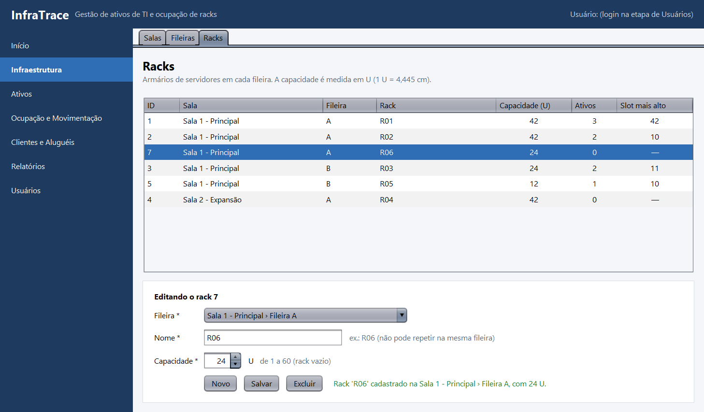

# Etapa 6.5 — Aba Racks

A aba **Racks** (menu Infraestrutura) fecha o cadastro físico: sala → fileira → rack. Segue o
padrão de Fileiras, com três novidades: um campo numérico (`JSpinner`), uma regra que só o
banco confere (trigger) e uma mensagem de exclusão que explica **tudo** o que prende o rack.

> **Atualização (etapa 6.7):** o menu Infraestrutura saiu. Rack agora é uma aba da janela
> principal, com o botão **Atualizar**. Veja [etapa-6.7.md](etapa-6.7.md).



## 1. Classes novas e alteradas

| Classe | Camada | O que faz |
|---|---|---|
| `model/Rack` | model | `id`, `nome`, `totalSlots`, `fileiraId` (colunas) + `salaNome`, `fileiraNome`, `quantidadeAtivos` e `maiorSlotOcupado` (só para exibição) |
| `dao/RackDAO` | dao | `listar` (2 JOINs + LEFT JOIN com `COUNT` e `MAX`), `inserir`, `atualizar`, `excluir` e `contarVinculos` |
| `service/RackService` | service | Nome até 128, fileira obrigatória, capacidade de 1 a 60, tradução dos erros 1062, 1452, 1644 e 1451 |
| `controller/RackController` | controller | Usa `FileiraService` (combo de fileiras) e `RackService` (tabela e gravação) |
| `view/PainelRacks` | view | Tabela + formulário com combo de fileiras e `JSpinner` de capacidade |
| `view/TelaPrincipal` | view | A aba Racks deixou de ser "em construção" |

"U" é a unidade de altura de rack (1 U = 4,445 cm). Um rack de 42 U tem os slots 1 a 42; um
servidor de 2 U ocupa dois slots seguidos (ex.: 20 e 21).

## 2. A consulta dos racks

```sql
SELECT r.rac_id, r.rac_nome, r.rac_total_slots, r.fk_fil_id,
       f.fil_nome, s.sal_nome,
       COUNT(a.atv_id)     AS qtd_ativos,     -- rack vazio: 0
       MAX(a.atv_slot_fim) AS maior_slot      -- rack vazio: NULL
  FROM rack r
  JOIN fileira f    ON f.fil_id = r.fk_fil_id     -- todo rack tem fileira
  JOIN sala s       ON s.sal_id = f.fk_sal_id     -- toda fileira tem sala
  LEFT JOIN ativo a ON a.fk_rac_id = r.rac_id     -- LEFT: rack sem ativo também aparece
 GROUP BY r.rac_id, r.rac_nome, r.rac_total_slots, r.fk_fil_id, f.fil_nome, s.sal_nome
 ORDER BY s.sal_nome, f.fil_nome, r.rac_nome
```

- É a mesma ideia da consulta de fileiras, com um JOIN a mais (rack → fileira → sala).
- `MAX(a.atv_slot_fim)` dá o slot mais alto ocupado. Num rack vazio não há linha de ativo, e o
  MAX devolve `NULL`. Por isso o DAO lê com `rs.getObject("maior_slot", Integer.class)`:
  `rs.getInt` transformaria o `NULL` em `0`, e "slot 0 ocupado" seria mentira.
- Ativos no estoque ou descartados têm `fk_rac_id` NULL e não entram na conta.

## 3. A capacidade: três camadas de proteção

| Camada | O que confere | Por quê |
|---|---|---|
| `JSpinner` (tela) | Setas de 1 a 60, começando em 42 | Conforto: o usuário quase nunca digita um valor errado |
| `RackService` | Número inteiro de 1 a 60 | Mensagem clara ("você informou 70"). O service **não confia na tela** |
| `CHECK ck_rac_total_slots` (banco) | `BETWEEN 1 AND 60` | Última defesa: vale para qualquer programa, inclusive o Python |

E uma regra que **só o banco** confere: o `Trigger_rack_reducao_capacidade` não deixa a
capacidade ficar menor que o slot mais alto ocupado. O Java não repete essa conta, por dois motivos:

1. A regra precisa valer para qualquer programa que altere o rack, não só para esta tela.
2. Se o Java consultasse antes e outro usuário instalasse um ativo logo depois, a conferência
   ficaria velha. O trigger confere no momento exato do `UPDATE`.

O erro chega como **1644** e o `RackService` acrescenta o que fazer. Para o usuário não tentar às
cegas, a tela mostra o limite **antes**: ao selecionar o R01, a dica diz "de 42 a 60 (o slot 42
está ocupado)" (vem do `MAX` da consulta).

### Detalhes do JSpinner

- `new SpinnerNumberModel(42, 1, 60, 1)`: valor inicial, mínimo, máximo e passo das setas.
- O JSpinner só aceita o que digitaram quando o texto é válido. Com o comportamento padrão, um
  "70" digitado **voltaria sozinho** para o valor anterior ao sair do campo, e o rack seria gravado
  com um número que o usuário não escolheu. Por isso:
  - `setFocusLostBehavior(JFormattedTextField.PERSIST)` mantém o "70" na tela;
  - `getCapacidade()` lê o **texto** do campo (e devolve `null` se não for número);
  - o service recusa com "A capacidade deve ficar entre 1 e 60 U (você informou 70)".

## 4. Excluir: por que o rack não pode sair

Três tabelas apontam para `rack`: `ativo`, `aluguel` e `movimentacao` (origem e destino). Se
qualquer uma tiver uma linha do rack, o `DELETE` é recusado com o erro **1451**.

Problema: a mensagem do MySQL cita **só a primeira** FK que bloqueou. No R01, ela fala do
aluguel e não diz nada dos 3 ativos instalados. Solução: depois que o banco recusa, o service
pergunta o motivo completo, com a mesma conexão:

```sql
SELECT (SELECT COUNT(*) FROM ativo   WHERE fk_rac_id = ?) AS ativos,
       (SELECT COUNT(*) FROM aluguel WHERE fk_rac_id = ?) AS alugueis,
       (SELECT COUNT(*) FROM movimentacao
         WHERE fk_rac_origem_id = ? OR fk_rac_destino_id = ?) AS movimentacoes
```

Resultado na tela: "Este rack não pode ser excluído porque tem 3 ativos instalados, 1 contrato
de aluguel e 1 movimentação no histórico. Contratos e movimentações são histórico e não são
apagados, por isso o rack continua cadastrado."

- **Quem decide é o banco** (a FK). A contagem só acontece depois da recusa, para explicar.
- O resultado volta num `record` (`RackDAO.Vinculos`). Um record é uma classe só de dados: o
  Java cria sozinho o construtor e os métodos `ativos()`, `alugueis()` e `movimentacoes()`.

## 5. Roteiro de teste (com `dados_exemplo.sql`)

| Ação | Resultado esperado |
|---|---|
| Abrir a aba Racks | 5 racks. R04 com 0 ativos e "—" em *Slot mais alto* |
| Selecionar R01 | Dica: "de 42 a 60 (o slot 42 está ocupado)" |
| R01 → capacidade 30 → Salvar | Aviso do trigger (1644): "O banco recusou a capacidade de 30 U: Capacidade menor que o maior slot ocupado no rack..." |
| R04 → capacidade 10 → Salvar | Funciona (rack vazio). Voltem para 42 depois |
| Novo → Sala 1 › Fileira A → nome R06 → capacidade 70 → Salvar | Aviso: "A capacidade deve ficar entre 1 e 60 U (você informou 70)." |
| Capacidade "abc" → Salvar | Aviso: "Informe a capacidade do rack: um número inteiro de 1 a 60." |
| Novo → Sala 1 › Fileira A → nome R01 → Salvar | Aviso: "Esta fileira já tem um rack chamado 'R01'." (UNIQUE → 1062) |
| Novo → Sala 2 › Fileira A → nome R01 → Salvar | Funciona: o nome é único só **dentro** da fileira |
| Selecionar R01 → Excluir → Sim | Aviso com os 3 ativos, 1 contrato e 1 movimentação |
| Selecionar o rack novo → Excluir → Sim | Rack removido |
| Aba Fileiras | A coluna *Racks* acompanha o que foi criado e excluído |

## 6. Exercício do grupo: coluna "Livres (U)"

Acrescentem à tabela de racks uma coluna com quantos slots ainda estão livres. Passa por três
camadas (DAO, model e view) e não precisa de controller nem service novos.

1. **`RackDAO.listar`**: acrescentem ao SELECT
   `COALESCE(SUM(a.atv_slot_fim - a.atv_slot_inicio + 1), 0) AS slots_ocupados`.
   - `atv_slot_fim - atv_slot_inicio + 1` = tamanho do ativo (slots 20 a 21 = 2 slots).
   - `SUM` de nenhuma linha dá `NULL`; o `COALESCE(..., 0)` troca o NULL por 0.
2. **`Rack`**: atributo `slotsOcupados` (com get/set) e um método
   `getSlotsLivres()` que devolve `totalSlots - slotsOcupados`.
3. **`PainelRacks`**: coluna "Livres (U)" no `modeloTabela` e o valor no `addRow`.
   Lembrem de ajustar o laço que centraliza as colunas numéricas.

Valores esperados com `dados_exemplo.sql`: R01 **37**, R02 **37**, R03 **21**, R04 **42**, R05 **2**.
Para conferir no Workbench: `SELECT rac_nome, slots_livres FROM View_ocupacao_rack;`
