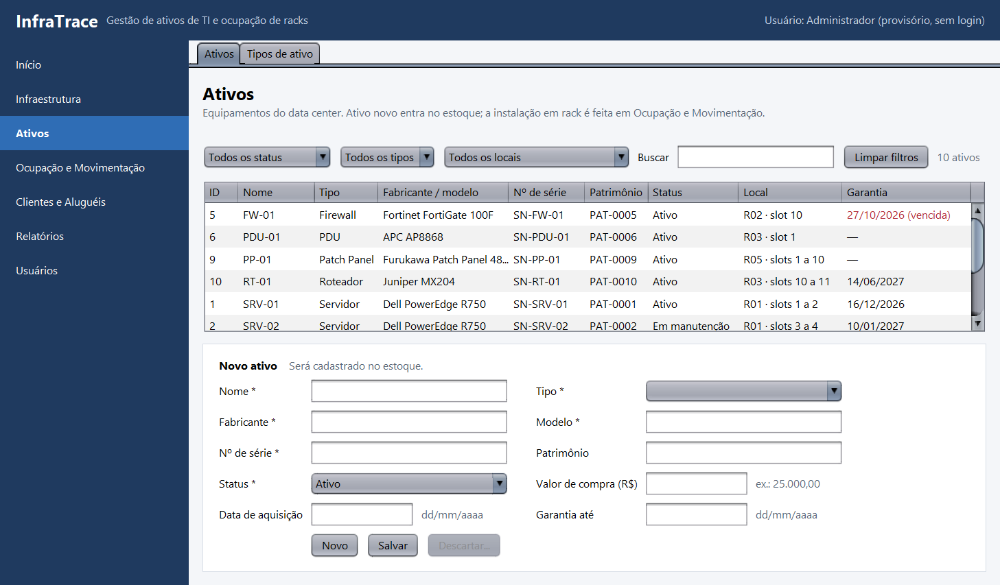
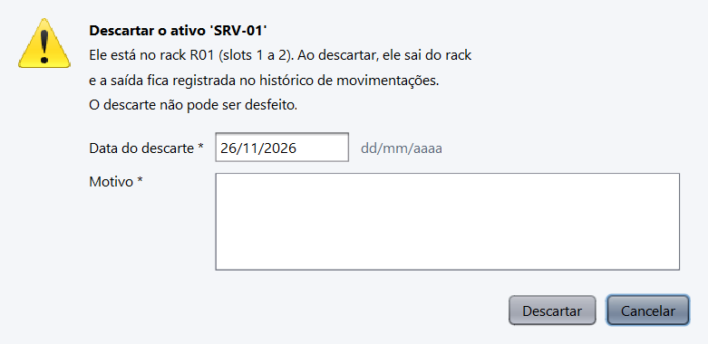

# Etapa 6.6 — Módulo Ativos

O menu **Ativos** ganhou a tela de equipamentos: lista com filtros, cadastro, alteração e
**descarte**. O descarte é a primeira operação do projeto feita como **transação no Java**
(`setAutoCommit(false)`, `commit` e `rollback`).

> **Atualização (etapa 6.7):**
> - Ativo agora é uma aba da janela principal. Os módulos Ocupação e Movimentação, Acesso e
>   Usuários e Relatórios, citados abaixo como "outro módulo", **saíram desta versão**. As
>   classes `Movimentacao`, `MovimentacaoDAO` e `Sessao` continuam, porque o descarte usa.
> - A garantia vencida não fica mais vermelha (continua com "(vencida)"), e o cabeçalho com o
>   usuário saiu.
> - O exercício da seção 9 (Tipos de ativo) foi resolvido.
> - A aba ganhou os botões **Atualizar** e **Relatório de garantias**, gerado por uma API em Python.
>
> Veja [etapa-6.7.md](etapa-6.7.md).



## 1. O que entra (e o que não entra) neste módulo

| Entra | Fica para outro módulo |
|---|---|
| Lista com filtros por status, tipo, local e texto | Instalar um ativo do estoque num rack, mudar de posição, retirar para o estoque: **Ocupação e Movimentação** |
| Cadastro (o ativo novo entra no **estoque**) e alteração dos dados e do status | Histórico de movimentações por ativo: **Ocupação e Movimentação** |
| Descarte com data e motivo (se estiver num rack, sai do rack na mesma transação) | Login: **Acesso e Usuários** (até lá, a `Sessao` usa o Administrador) |
| Aba "Tipos de ativo": **exercício do grupo** (seção 9) | Nota fiscal: sem tela nesta versão (a coluna `fk_nff_id` é preservada) |

**Ativo não se exclui, se descarta.** Ativo é patrimônio: o registro continua existindo (com
data e motivo do descarte), e o histórico de movimentações continua apontando para ele.

## 2. Classes novas e alteradas

| Classe | Camada | O que faz |
|---|---|---|
| `model/Ativo` | model | Espelha a tabela `ativo` (datas em `LocalDate`, valor em `BigDecimal`) + nomes do tipo, rack, fileira e sala para exibição |
| `model/StatusAtivo` | model | **enum** com os 5 status do CHECK `ck_atv_status` |
| `model/TipoAtivo` | model | Espelha `tipo_ativo` |
| `model/FiltroAtivo` | model | O que foi escolhido na barra de filtros (não é tabela) |
| `model/Movimentacao` | model | Espelha `movimentacao` (usada no descarte e, depois, no módulo de Ocupação) |
| `dao/AtivoDAO` | dao | `listar` (com filtros), `buscarPorId` (com trava opcional), `inserir`, `atualizar`, `descartar` |
| `dao/MovimentacaoDAO` | dao | `inserir`, sem commit próprio (usa a transação de quem chama) |
| `dao/TipoAtivoDAO` | dao | `listar` (o resto é o exercício) |
| `service/AtivoService` | service | Validações, tradução dos erros e a **transação do descarte** |
| `service/TipoAtivoService` | service | `listar` (o resto é o exercício) |
| `controller/AtivoController` | controller | Converte texto em data/valor, chama os services, reabre a janela de descarte se faltar algo |
| `view/PainelAtivos` | view | Filtros + tabela + formulário + janela de descarte |
| `util/Formatos` | util | **Pacote novo.** Datas `dd/mm/aaaa` e valores `25.000,00` (mostrar e ler) |
| `config/Sessao` | config | **Provisório:** o usuário atual (o Administrador, até o login existir) |
| `view/TelaPrincipal`, `view/Estilo` | view | Abas do módulo Ativos, usuário no cabeçalho e a cor de alerta |

## 3. Filtros: SQL montado aos poucos, mas sem perigo

```java
StringBuilder sql = new StringBuilder(SELECT_ATIVO).append(" WHERE 1 = 1");
List<Object> parametros = new ArrayList<>();

if (filtro.getStatus() != null) {
    sql.append(" AND a.atv_status = ?");          // o TEXTO do SQL só ganha um "?"
    parametros.add(filtro.getStatus().name());    // o VALOR vai para a lista
}
// ... tipo, local e texto do mesmo jeito ...
for (int i = 0; i < parametros.size(); i++) {
    ps.setObject(i + 1, parametros.get(i));
}
```

- **`WHERE 1 = 1`** é sempre verdadeiro. Serve só para todo filtro poder começar com `AND`.
- O que o usuário digita **nunca** é colado no SQL. Buscar `' OR 1=1 --` não quebra nada:
  é procurado como texto e não acha nenhum ativo.
- No `LIKE`, `%` e `_` são curingas. O DAO coloca uma `\` antes deles, para que buscar
  `pat_` procure um "_" de verdade (e não "pat" + qualquer letra).
- `LEFT JOIN rack/fileira/sala`: o ativo no estoque não tem rack e, com `JOIN` normal, sumiria.
- "Somente estoque" = sem rack **e** não descartado (o descartado também está sem rack).

## 4. Datas, dinheiro e status

| Coluna | Tipo no Java | Por quê |
|---|---|---|
| `DATE` | `LocalDate` | Só a data, sem hora e sem fuso. JDBC: `ps.setObject(i, data)` e `rs.getObject("col", LocalDate.class)` |
| `DECIMAL(10,2)` | `BigDecimal` | `double` erra centavos (`0.1 + 0.2` dá `0.30000000000000004`). Dinheiro é sempre `BigDecimal` |
| `atv_status` | `enum StatusAtivo` | O compilador só aceita os 5 valores do CHECK. No banco vai o `name()`; na tela, o rótulo |

**O que é digitado chega como texto.** Quem converte é o controller, com o `Formatos`:

- Data: `dd/mm/aaaa` com `ResolverStyle.STRICT`, que recusa `31/02/2026` (sem ele, o Java
  "corrigiria" para 28/02 sem avisar).
- Valor: aceita `25000`, `25000,5`, `25.000,50` e `R$ 25.000,50`. **Recusa `25000.50`**, porque
  no Brasil o ponto é separador de milhar e o valor poderia virar 2.500.050.
- Texto inválido vira `NegocioException`, e o aviso aparece como qualquer outra regra.

**Patrimônio vazio vira `NULL`.** O `UNIQUE (atv_patrimonio)` aceita vários `NULL`, mas não aceitaria
dois textos vazios `''`. O `Validacoes.textoOpcional` já fazia essa troca.

**Qual campo está repetido?** O erro 1062 traz o nome da chave
(`Duplicate entry 'SN-SRV-01' for key 'ativo.uq_atv_num_serie'`), e o service escolhe a mensagem
pelo nome: número de série ou patrimônio.

## 5. O descarte: uma transação no Java



Um ativo que está num rack precisa de **dois** comandos para ser descartado:

```
1. INSERT INTO movimentacao (...)   -- registra a saída: origem = rack e slots; destino = vazio
2. UPDATE ativo SET atv_status = 'DESCARTADO', data, motivo, fk_rac_id = NULL, slots = NULL
```

Se o passo 2 falhasse depois do passo 1, o histórico diria que o ativo saiu do rack, mas ele
continuaria lá. Por isso os dois vão numa transação (`AtivoService.descartar`):

```java
try (Connection con = Conexao.getConexao()) {
    con.setAutoCommit(false);                       // nada é gravado até o commit
    try {
        Ativo ativo = ativoDAO.buscarPorId(con, id, true);   // FOR UPDATE: trava o ativo
        conferirSePodeDescartar(ativo, data);
        if (ativo.estaEmRack()) {
            movimentacaoDAO.inserir(con, saidaDoRack(ativo, motivo, usuarioId));   // passo 1
        }
        ativoDAO.descartar(con, id, data, motivo);                                // passo 2
        con.commit();                               // os dois ficam gravados juntos
        return ativo;
    } catch (SQLException | RuntimeException e) {
        con.rollback();                             // desfaz o passo 1 se o 2 falhar
        throw e;
    }
}
```

- **Os DAOs recebem a mesma `Connection`.** É isso que coloca os dois comandos na mesma transação.
  Desde a etapa 6.2 os DAOs recebem a conexão de quem chama; este é o motivo.
- **`FOR UPDATE OF a`** trava a linha do ativo até o commit/rollback. Se outra pessoa tentar
  mover o mesmo ativo nesse instante, ela espera.
- **Testado:** com uma falha forçada no passo 2, o número de movimentações e a posição do ativo
  ficaram iguais antes e depois. O rollback desfez o passo 1 (veja a seção 8).
- **Comparação com a etapa 6.1:** a movimentação comum é feita pela `Procedure_movimentar_ativo`,
  com a transação **dentro do MySQL**. Aqui, a transação é controlada **pelo Java**. O projeto mostra
  os dois jeitos.
- **Por que o motivo aceita 502 caracteres, e não 512?** Na movimentação ele é gravado como
  `"Descarte: " + motivo`, e `mov_motivo` tem 512. Com 512 no motivo, o `INSERT` estouraria a coluna.
- **Quem fez:** `movimentacao.fk_usr_id` é obrigatório. Até o login existir, a `Sessao` informa o
  Administrador (id 1). O cabeçalho da janela avisa: "Administrador (provisório, sem login)".
- **Se faltar o motivo**, aparece o aviso e a janela **reabre com o que já foi digitado**.

## 6. Alteração e ativo descartado

- O `UPDATE` só mexe nos dados cadastrais e no status. Rack, slots, descarte, nota fiscal e data de
  criação ficam como estão. Mudar a posição é assunto do módulo de Ocupação.
- `DESCARTADO` não aparece no campo Status: só o botão **Descartar** grava esse status (com data,
  motivo e saída do rack).
- Ativo descartado aparece **só para leitura** (Salvar e Descartar desligados). No banco, o
  `UPDATE ... WHERE atv_id = ? AND atv_status <> 'DESCARTADO'` garante isso mesmo que outro
  usuário descarte o ativo um instante antes.
- A coluna Garantia fica **vermelha com "(vencida)"** quando a data já passou.

## 7. Roteiro de teste (com `dados_exemplo.sql`)

| Ação | Resultado esperado |
|---|---|
| Menu **Ativos** | 10 ativos. FW-01 com a garantia em vermelho "(vencida)"; SRV-OLD como "Descartado" |
| Local → "Somente estoque" | Só o SRV-03 (o SRV-OLD não conta: está descartado) |
| + Status → "Ativo" | Continua o SRV-03 (os filtros se somam) |
| Limpar filtros → Buscar `pat_` + Enter | Nenhum ativo (o `_` é procurado como letra) |
| Selecionar SRV-OLD | "Ativo 8 (descartado: somente leitura)", Salvar e Descartar desligados |
| Novo → SRV-05, Lenovo, ThinkSystem SR650, SN-SRV-05, tipo Servidor, valor `31500.00` → Salvar | Aviso: valor com vírgula nos centavos |
| Valor `31.500,00` → Salvar | "Ativo 'SRV-05' cadastrado no estoque (id 11)." Local: Estoque |
| Novo → campos obrigatórios preenchidos e nº de série `SN-SRV-01` → Salvar | "Já existe um ativo com o número de série 'SN-SRV-01'." |
| Aquisição `01/10/2026`, garantia `01/09/2026` → Salvar | "A garantia não pode vencer antes da data de aquisição (01/10/2026)." |
| SRV-02 → Status "Ativo" → Salvar | Salvo; o local continua "R01 · slots 3 a 4" |
| SRV-01 → **Descartar...** | A janela diz que ele está no R01 (slots 1 a 2) e que a saída vai para o histórico |
| Motivo vazio → Descartar | Aviso; a janela volta com a data preenchida |
| Motivo "Fim do contrato de suporte" → Descartar | Mensagem verde; SRV-01 vira "Descartado" e sai do R01 |
| Infraestrutura → Racks | R01 com 2 ativos (antes eram 3) |
| Workbench: `SELECT * FROM movimentacao ORDER BY mov_id DESC LIMIT 1;` | `Descarte: Fim do contrato de suporte`, origem rack 1, slots 1 a 2, usuário 1 |

## 8. Atividade opcional: ver o rollback acontecer

No Workbench, crie um trigger que **simula uma falha** no passo 2 do descarte do FW-01 (id 5):

```sql
USE infratrace_v2;
DELIMITER $$
CREATE TRIGGER teste_falha_descarte BEFORE UPDATE ON ativo FOR EACH ROW
BEGIN
    IF NEW.atv_status = 'DESCARTADO' AND OLD.atv_id = 5 THEN
        SIGNAL SQLSTATE '45000' SET MESSAGE_TEXT = 'Falha simulada no passo 2';
    END IF;
END$$
DELIMITER ;
SELECT COUNT(*) FROM movimentacao;   -- anote o número
```

No sistema, descarte o FW-01: aparece o erro "Falha simulada no passo 2". Rode o `SELECT COUNT(*)`
de novo: **o número não mudou**, mesmo o passo 1 (INSERT) tendo sido executado. O FW-01 continua no
R02. Depois, **apague o trigger**:

```sql
DROP TRIGGER teste_falha_descarte;
```

Para ver o contrário, comente as três linhas `con.setAutoCommit(false)`, `con.commit()` e
`con.rollback()` e repita: agora a movimentação fica gravada, mas o ativo continua no rack. É
exatamente o erro que a transação evita. Desfaçam a alteração no código depois do teste (com o
`commit()` comentado, nenhum descarte funcionaria direito).

## 9. Exercício do grupo: a aba "Tipos de ativo"

> **Atualização:** a aba Tipo Ativo foi feita na etapa 6.7 ([etapa-6.7.md, seção 4](etapa-6.7.md#4-cadastro-de-tipo-ativo)).
> Usem o enunciado abaixo para comparar com a solução.

É um cadastro igual ao de **Salas** (nome obrigatório e único, descrição opcional):

| Peça | O que fazer |
|---|---|
| `dao/TipoAtivoDAO` | Já tem `listar`. Escrevam `inserir`, `atualizar` e `excluir` (copiem a ideia do `SalaDAO`; colunas `tpa_nome` e `tpa_descricao`) |
| `service/TipoAtivoService` | `salvar`: nome até 128 e descrição até 512; 1062 → "Já existe um tipo chamado 'X'." `excluir`: 1451 → "Há ativos deste tipo; ele não pode ser excluído." |
| `controller/TipoAtivoController` | Igual ao `SalaController` |
| `view/PainelTiposAtivo` | Igual ao `PainelSalas` (estende `PainelBase`) |
| `view/TelaPrincipal` | Trocar o `criarEmConstrucao("Tipos de ativo", ...)` por `new PainelTiposAtivo()` |

Teste: cadastrar "Load Balancer" → ele aparece no combo **Tipo** da aba Ativos (a lista é
recarregada quando a aba aparece). Cadastrar "Switch" de novo → aviso do 1062. Excluir
"Servidor" → aviso do 1451 (há ativos desse tipo). Excluir "Load Balancer" → funciona.
