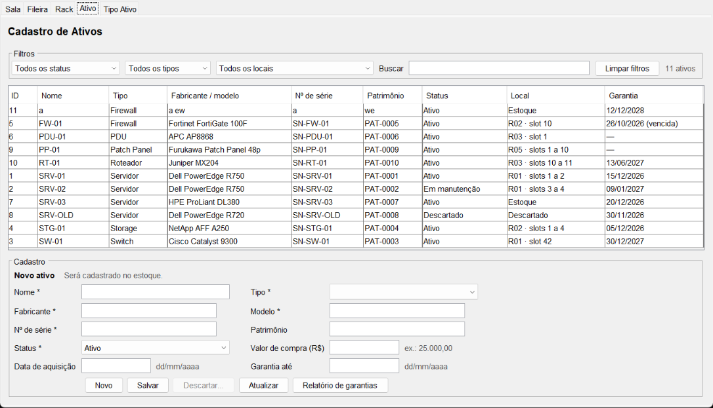
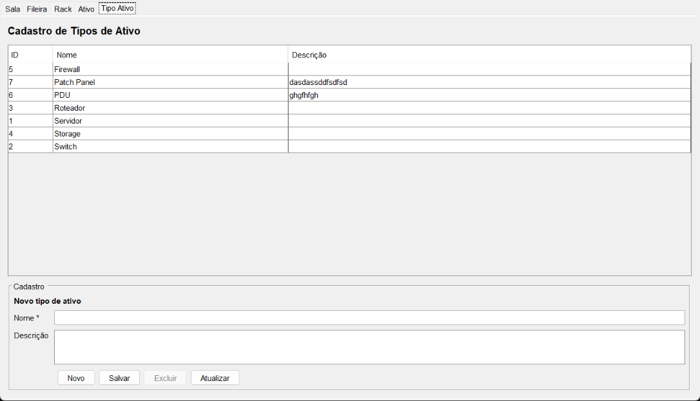
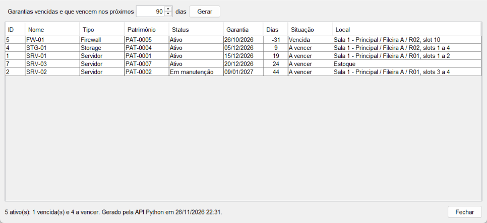

# Etapa 6.7 — Interface simplificada, Tipo Ativo e relatório em Python

Esta etapa faz três coisas:

1. **Simplifica a interface**: a janela passa a ter só os cinco módulos que funcionam (Sala,
   Fileira, Rack, Ativo e Tipo Ativo), em abas, com o visual padrão do Swing e tons neutros.
2. **Completa o cadastro de Tipo Ativo** (era o exercício da [etapa 6.6, seção 9](etapa-6.6.md#9-exercício-do-grupo-a-aba-tipos-de-ativo)).
3. **Coloca o Python no projeto**: o botão **Relatório de garantias**, na aba Ativo, mostra um
   relatório gerado por uma API em Python (Flask).

Nada mudou no banco de dados nem nas regras de negócio de Sala, Fileira, Rack e Ativo.



## 1. Resumo das mudanças

| Antes | Depois |
|---|---|
| Menu lateral azul com 7 módulos (Início, Infraestrutura, Ativos, Ocupação e Movimentação, Clientes e Aluguéis, Relatórios, Usuários) | Um `JTabbedPane` com 5 abas: **Sala, Fileira, Rack, Ativo, Tipo Ativo** |
| Visual Nimbus com cores azuis, cabeçalho colorido e "Usuário: Administrador" | Visual do sistema operacional, fonte SansSerif, sem cabeçalho |
| Mensagem de sucesso em verde; garantia vencida em vermelho | Texto comum; a garantia vencida continua com "(vencida)" |
| Aba "Tipos de ativo" em construção | Cadastro completo de Tipo Ativo |
| Nenhum código Python | API Flask em `python/` + botão **Relatório de garantias** |
| Pacotes `br.com.infratrace.*` | Pacotes curtos: `Model`, `Dao`, `Services`... (seção 3) |

## 2. Interface

### 2.1 Navegação

A `TelaPrincipal` ficou com poucas linhas: cria as cinco telas e põe cada uma numa aba.

```java
JTabbedPane abas = new JTabbedPane();
abas.addTab("Sala", new PainelSalas());
abas.addTab("Fileira", new PainelFileiras());
abas.addTab("Rack", new PainelRacks());
abas.addTab("Ativo", new PainelAtivos());
abas.addTab("Tipo Ativo", new PainelTiposAtivo());
```

Saíram o menu lateral, o cabeçalho, a tela de Início e os cartões "em construção" de Ocupação e
Movimentação, Clientes e Aluguéis, Relatórios e Usuários. Esses módulos não tinham telas nem
classes por trás, então nenhuma regra foi perdida.

**Continuam no projeto:** `Movimentacao`, `MovimentacaoDAO` e `Sessao`. O descarte de um ativo
grava a saída do rack na tabela `movimentacao` com o id do usuário (`Sessao`), como explica a
[etapa 6.6, seção 5](etapa-6.6.md).

Cada tela continua recarregando os dados do banco **sempre que a aba aparece**. Por isso uma sala
nova já aparece no combo da aba Fileira, e um tipo novo aparece no combo da aba Ativo.

### 2.2 Visual

| Classe | O que faz agora |
|---|---|
| `Infratrace/App` | `UIManager.setLookAndFeel(UIManager.getSystemLookAndFeelClassName())`: botões e campos com o visual do Windows. Depois troca a fonte de todos os componentes pela SansSerif 12 |
| `View/Estilo` | Só as fontes, um cinza para as dicas (`CINZA_TEXTO`) e o método `titulo("Cadastro de ...")` |
| `View/PainelBase` | O formulário fica num quadro com o título "Cadastro" (`createTitledBorder`). A mensagem de sucesso aparece em texto comum ao lado dos botões |

### 2.3 Padrão de cada tela

Todas as telas seguem a mesma estrutura: **título** em cima, **tabela** no meio e o quadro
**Cadastro** embaixo, com os botões:

| Botão | O que faz |
|---|---|
| Novo | Limpa o formulário para cadastrar outro registro |
| Salvar | Grava: `INSERT` se for novo, `UPDATE` se uma linha da tabela estiver selecionada |
| Excluir | Pede confirmação e exclui o registro selecionado (na aba Ativo é **Descartar...**) |
| Atualizar | Relê os dados do banco (útil se outra pessoa mudou algo) |

Avisos e erros continuam em janelas (`JOptionPane`), como antes.

## 3. Pacotes do projeto Java

Os pacotes foram renomeados para nomes curtos. As classes e o que cada uma faz continuam iguais.

| Antes | Agora | Exemplos |
|---|---|---|
| `br.com.infratrace` | `Infratrace` | `App` |
| `br.com.infratrace.config` | `Configuracao` | `Configuracao`, `Conexao`, `Sessao`, `TesteConexao` |
| `br.com.infratrace.model` | `Model` | `Sala`, `Ativo`, `TipoAtivo`, `RelatorioGarantias` |
| `br.com.infratrace.dao` | `Dao` | `SalaDAO`, `TipoAtivoDAO` |
| `br.com.infratrace.service` | `Services` | `SalaService`, `Validacoes` |
| `br.com.infratrace.controller` | `Controllers` | `SalaController`, `TratamentoDeErros` |
| `br.com.infratrace.exception` | `Exceptions` | `NegocioException`, `ErrosBanco` |
| `br.com.infratrace.view` | `View` | `TelaPrincipal`, `PainelSalas` |
| `br.com.infratrace.integracao` | (não mudou) | `RelatorioApi` |
| `br.com.infratrace.util` | (não mudou) | `Formatos` |

O `pom.xml` foi ajustado para a classe principal nova: `<exec.mainClass>Infratrace.App</exec.mainClass>`.

## 4. Cadastro de Tipo Ativo



Feito exatamente como pedia o exercício da etapa 6.6, copiando o padrão de Sala:

| Classe | O que tem |
|---|---|
| `Dao/TipoAtivoDAO` | `listar` (já existia), `inserir`, `atualizar` e `excluir` |
| `Services/TipoAtivoService` | Nome obrigatório (até 128) e descrição opcional (até 512). Erro 1062 → "Já existe um tipo de ativo com o nome 'X'." Erro 1451 → "Este tipo é usado por ativos cadastrados e não pode ser excluído." |
| `Controllers/TipoAtivoController` | Igual ao `SalaController` |
| `View/PainelTiposAtivo` | Igual ao `PainelSalas` |

As regras de nome único e de tipo em uso são garantidas pelo banco (`uq_tpa_nome` e
`fk_atv_tipo_ativo`). O service só traduz o código do erro numa mensagem clara.

## 5. Relatório de garantias em Python



### 5.1 Como as partes conversam

```
Aba Ativo ─► botão "Relatório de garantias"
              │
              ▼
   DialogoRelatorioGarantias ─► RelatorioGarantiasController ─► RelatorioApi
   (View)                       (Controllers)                    (integracao)
                                                                     │ HTTP GET
                                                                     ▼
                                       API Python (python/app.py) em 127.0.0.1:5000
                                                                     │ SELECT
                                                                     ▼
                                                  MySQL: View_garantia_ativo
```

- O **Java** continua sendo a única tela e o único que **grava** no banco.
- O **Python** só **lê**: consulta a view `View_garantia_ativo` (criada pelo script do banco na
  etapa 6.1), classifica cada garantia e devolve o resultado em **JSON**.
- O endereço da API fica no `.env` (`INFRATRACE_API_URL=http://127.0.0.1:5000`), o mesmo arquivo
  que os dois programas leem.

### 5.2 A API (`python/app.py`)

| Rota | O que devolve |
|---|---|
| `GET /status` | `{"status": "ok"}`, só para conferir se a API está no ar |
| `GET /relatorios/garantias?dias=90` | Garantias **vencidas** e as que **vencem nos próximos N dias** (N de 0 a 3650; padrão 90) |

Exemplo de resposta (resumido):

```json
{
  "gerado_em": "26/11/2026 22:28",
  "limite_dias": 90,
  "total": 5,
  "vencidas": 1,
  "a_vencer": 4,
  "itens": [
    {"id": 5, "nome": "FW-01", "tipo": "Firewall", "patrimonio": "PAT-0005", "status": "Ativo",
     "garantia": "26/10/2026", "dias_restantes": -31, "situacao": "Vencida",
     "local": "Sala 1 - Principal / Fileira A / R02, slot 10"}
  ]
}
```

O que o Python faz em cada etapa:

1. `ler_env()` lê o `.env` da raiz do projeto, no mesmo formato `CHAVE=VALOR` que o Java usa.
2. `buscar_garantias(dias)` roda o `SELECT` na view com `%s` (parâmetro, sem risco de SQL
   Injection), ordenando do mais urgente para o menos urgente.
3. `situacao()` classifica: dias negativos → "Vencida"; 0 → "Vence hoje"; positivo → "A vencer".
4. `local()` monta o texto "Sala / Fileira / Rack, slots" ou "Estoque".
5. Parâmetro inválido (`dias=abc`) → HTTP **400** com `{"erro": "..."}`. Erro no banco → HTTP **500**.

Bibliotecas (`python/requirements.txt`): `flask` (a API) e `mysql-connector-python` (o driver do
MySQL para Python).

### 5.3 O lado Java

| Classe | O que faz |
|---|---|
| `br.com.infratrace.integracao.RelatorioApi` | Faz o `GET` com o `HttpClient` (já vem no Java 21) e converte o JSON com o **Gson**. É o "DAO da API": o DAO fala SQL com o MySQL, esta classe fala HTTP com o Python |
| `Model/RelatorioGarantias` | O resultado do relatório (totais + lista de itens). O Gson preenche os campos: `dias_restantes` no JSON vira `diasRestantes` no Java |
| `Controllers/RelatorioGarantiasController` | Pede o relatório à API e manda a janela mostrar, ou mostra o erro |
| `View/DialogoRelatorioGarantias` | A janela: campo "próximos N dias", botão Gerar, tabela e resumo |

O **Gson** (biblioteca do Google) entrou no `pom.xml`. O NetBeans baixa sozinho na primeira vez
(precisa de internet).

**Se a API não estiver rodando**, só o relatório é afetado: aparece o erro "A API Python não está
respondendo em http://127.0.0.1:5000. Inicie a API: na pasta python do projeto, rode
'python app.py'". Os cadastros continuam funcionando normalmente.

## 6. Como rodar a API

Precisa do **Python 3.12 ou mais novo** (testado no 3.15). Na primeira vez, num terminal:

```
cd infratrace_v2\python
python -m venv .venv
.venv\Scripts\activate
pip install -r requirements.txt
```

O `.venv` é um **ambiente virtual**: uma pasta com as bibliotecas só deste projeto. Ela está no
`.gitignore` e cada integrante cria a sua.

Depois, toda vez que for usar o sistema:

```
cd infratrace_v2\python
.venv\Scripts\activate
python app.py
```

Deixem esse terminal aberto: ele é o servidor. Para parar, **Ctrl+C**.

## 7. A pasta python dentro do NetBeans

O projeto do NetBeans é só a pasta `java\InfraTrace`, por isso a pasta `python` não aparece na
janela *Projects*. O NetBeans atual também **não executa Python**. Mas dá para ver, editar e
rodar os arquivos sem sair dele:

**Ver e editar os arquivos (janela *Favorites*):**

1. *Window → Favorites* (Ctrl+3).
2. Botão direito na janela *Favorites* → *Add to Favorites...*
3. Escolham a pasta `infratrace_v2\python` → **Add**.

A pasta passa a aparecer na *Favorites* e fica lá nas próximas vezes. Dois cliques no `app.py`
abrem o arquivo para edição, como texto (sem autocompletar de Python). Do mesmo jeito dá para
adicionar a pasta `docs` ou o `.env`.

**Rodar a API (janela *Terminal*):**

1. *Window → IDE Tools → Terminal*.
2. Digitem os comandos da seção 6 (`cd`, `activate`, `python app.py`).

Quem preferir pode editar o Python no **VS Code** com a extensão Python, que tem cores,
autocompletar e depurador para Python.

## 8. Como testar a parte em Python

São três jeitos, do mais isolado ao mais completo.

### 8.1 Testes automáticos (`python/test_app.py`)

Testam a API **sem o Java e sem iniciar o servidor**. O Flask tem um "cliente de teste" que
chama as rotas direto.

```
cd infratrace_v2\python
.venv\Scripts\activate
python -m unittest -v
```

Resultado esperado: `Ran 8 tests ... OK`.

| Teste | O que confere |
|---|---|
| `test_situacao` | -1 → "Vencida", 0 → "Vence hoje", 30 → "A vencer" |
| `test_local_no_estoque`, `test_local_no_rack`, `test_local_um_slot` | O texto do local ("Estoque", "slots 1 a 2", "slot 10") |
| `test_status` | `/status` responde `{"status": "ok"}` |
| `test_dias_invalido` | `dias=abc`, `-5` e `9999` → HTTP 400 com a mensagem de erro |
| `test_relatorio` | Os totais batem com a lista, a lista vem ordenada, nenhum ativo descartado, datas em dd/mm/aaaa |
| `test_padrao_90_dias` | Sem `?dias=`, o limite é 90 |

Os quatro primeiros não usam o banco. Os outros leem o banco do `.env`, mas **não gravam nada**.

### 8.2 Pelo navegador

Com a API rodando (`python app.py`), abram:

- <http://127.0.0.1:5000/status>
- <http://127.0.0.1:5000/relatorios/garantias?dias=90>
- <http://127.0.0.1:5000/relatorios/garantias?dias=abc> (deve mostrar o erro)

O navegador mostra o JSON que o Java vai receber. Bom para conferir os dados antes de olhar a tela.

### 8.3 Pelo sistema (Python + Java juntos)

Com a API rodando: no NetBeans, **F6** → aba **Ativo** → **Relatório de garantias**.

## 9. Roteiro de teste (com `dados_exemplo.sql`)

Os dias restantes dependem da data de hoje (a view usa `CURDATE()`). Os resultados abaixo são de
26/11/2026.

| Ação | Resultado esperado |
|---|---|
| F6 | Janela com as abas Sala, Fileira, Rack, Ativo e Tipo Ativo. Nenhum menu ou módulo além desses |
| Aba **Tipo Ativo** → Novo → "Load Balancer" → Salvar | "Tipo 'Load Balancer' cadastrado (id ...)." |
| Aba **Ativo** → Novo → combo Tipo | "Load Balancer" aparece na lista |
| Aba **Tipo Ativo** → Novo → "Switch" → Salvar | Aviso: "Já existe um tipo de ativo com o nome 'Switch'." |
| Selecionar "Servidor" → Excluir → Sim | Aviso: o tipo é usado por ativos e não pode ser excluído |
| Selecionar "Load Balancer" → Excluir → Sim | "Tipo 'Load Balancer' excluído." |
| API **desligada** → aba Ativo → **Relatório de garantias** | Erro "A API Python não está respondendo..."; a janela abre vazia |
| `python app.py` → **Gerar** na janela do relatório | 5 ativos: FW-01 "Vencida" (-31); STG-01, SRV-01, SRV-03 (Estoque) e SRV-02 "A vencer" |
| Dias = 0 → Gerar | Só o FW-01 |
| Dias = 365 → Gerar | 6 ativos: os 5 anteriores + RT-01 (garantia em 13/06/2027) |
| `python -m unittest -v` | `Ran 8 tests ... OK` |

## 10. Erros comuns

| Sintoma | Causa | Solução |
|---|---|---|
| "A API Python não está respondendo em http://127.0.0.1:5000" | A API não foi iniciada, ou o terminal foi fechado | Rodar `python app.py` na pasta `python` e deixar o terminal aberto |
| `python` abre a Microsoft Store | O Python não está instalado, ou o terminal foi aberto antes da instalação | Instalar o Python 3.12+ e abrir um terminal **novo** |
| `No module named 'flask'` | O `.venv` não foi ativado ou as bibliotecas não foram instaladas | `.venv\Scripts\activate` e `pip install -r requirements.txt` |
| No PowerShell, o `activate` diz que a execução de scripts está desabilitada | Política de segurança do PowerShell | Usar o Prompt de Comando (cmd), ou rodar sem ativar: `.venv\Scripts\python app.py` |
| `KeyError: 'INFRATRACE_DB_HOST'` ao chamar o relatório | O `.env` está incompleto | Conferir o `.env` com o `.env.example` |
| `Address already in use` / porta 5000 ocupada | A API já está aberta em outro terminal | Usar a que já está aberta, ou fechá-la com Ctrl+C |
| F6 pede *Select Main Class* | O `exec.mainClass` do `pom.xml` não foi lido | Escolher `Infratrace.App` |
